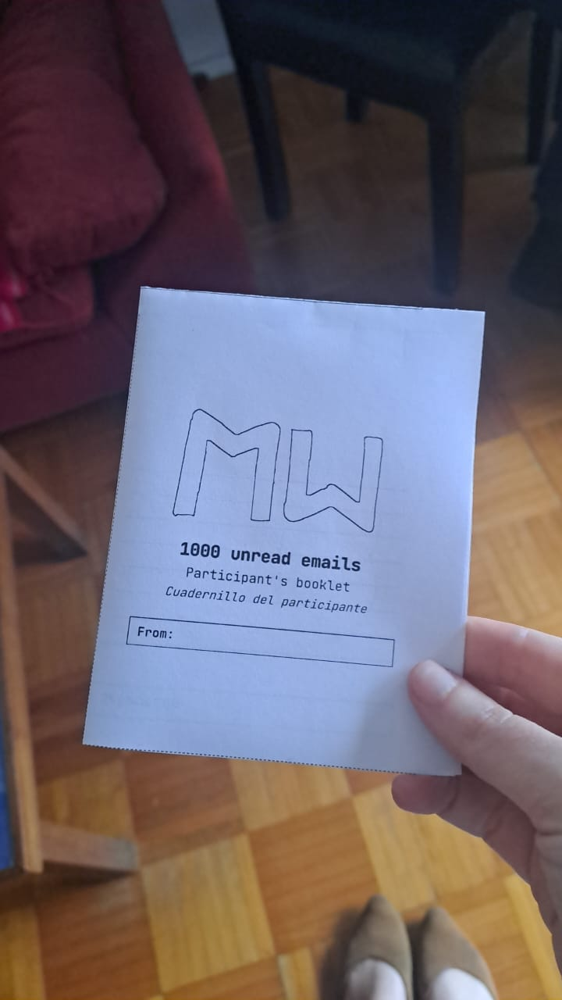
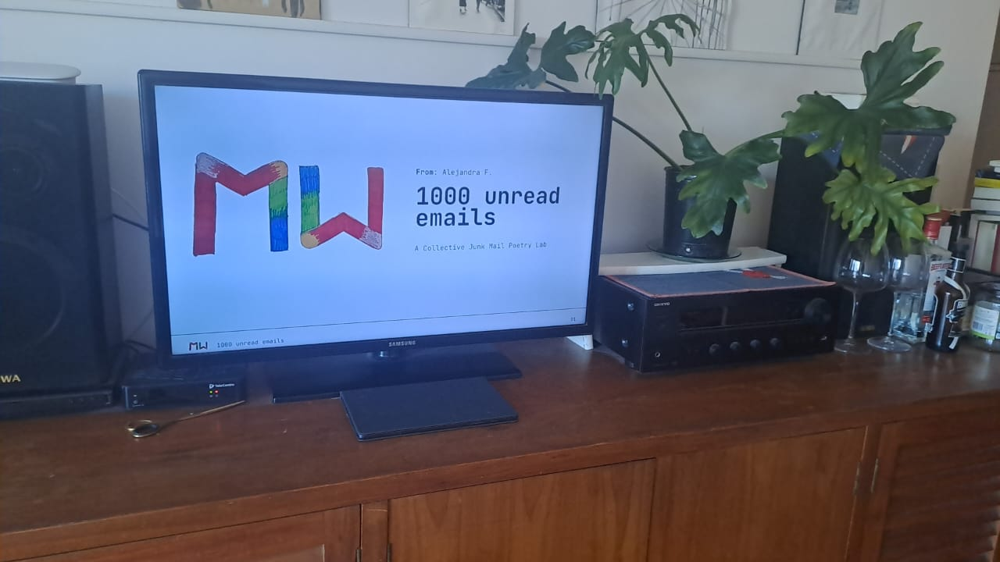

# 1000 unread emails

**1000 unread emails** is a collection of poems made out of email subjects from big techs, social media, banks, streaming platforms and other digital services. The subject lines that pile up in our inboxes, unread, are cut up and rearranged into short poems.

The project started as a workshop for MozFest 2026. Anyone can contribute a poem through the website's submission form, or run their own workshop with the materials in this repository.

More notes on motivations: [eseldesvelo.substack.com](https://eseldesvelo.substack.com)

## What's in this repository

This repository holds three things:

### 1. The website

The site that shows the collection, explains the project, takes submissions and offers the workshop materials for download.

- `index.html`, `support.js`, `poems.js`, `styles.css`
- Setup and maintenance: see [SITE-README.md](SITE-README.md)

### 2. The productions (poems)

The poems made by workshop participants and contributors, stored as images in [`assets/poems/`](assets/poems/). The website lists this folder automatically, so adding a poem is as simple as uploading its image.

### 3. Workshop materials

Everything needed to run a "1000 unread emails" workshop, in [`resources/`](resources/):

- `facilitators-guide_en.pdf` — facilitator's guide (English)
- `facilitators-guide_es.pdf` — facilitator's guide (Spanish)
- `slide-deck.pdf` — slides to project during the session
- `participant-booklet.pdf` — booklet for participants
- `poem-card.pdf` — cards to compose the poems

The participant's booklet, printed and folded:

The slides in action during a workshop:

## Design system

The visual identity shared by the website, slides and guides (type, color, layout rules, logo use) is documented in [DESIGN-SYSTEM.md](DESIGN-SYSTEM.md).
